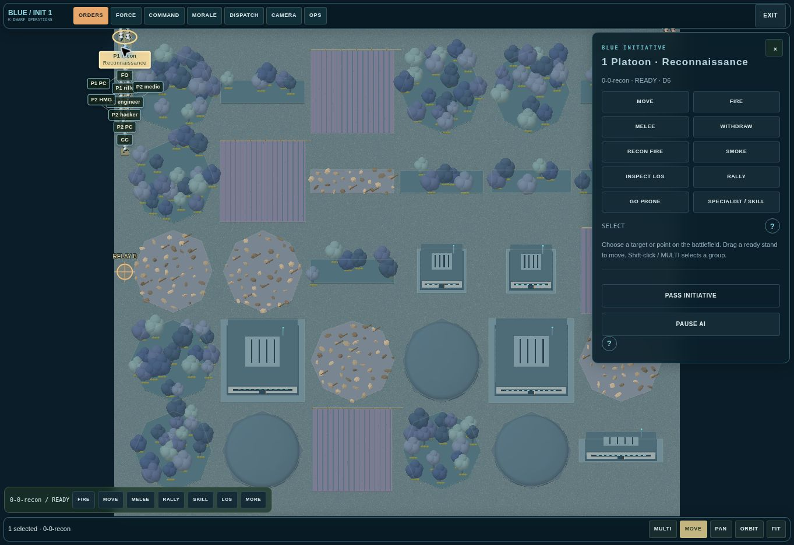

# K-Dwarf: Operations

Nathan Culver's science-fiction tabletop browser game, adapted from his K-Dwarf design document using the [Crossfire digital tabletop](https://github.com/Nathan-Culver/crossfire) foundation.

**Version 0.3.0 alpha.** The core operation can reach a victory result. This is an unfinished implementation, with [explicit rule coverage and remaining work](docs/COVERAGE.md). It is not an exhaustive or certified reproduction of the draft.

## Play

**Play:** https://nathan-culver.github.io/k-dwarf/

GitHub Pages serves the root. Use the local build below for development.

1. Open **Operations → New operation**. Choose solo Easy/Normal/Hard or same-device hotseat.
2. Use **Force Forge** to build both forces and **Battlefield fabrication** to draw terrain, generate a map, or load one of ten saved maps.
3. Resolve recon supremacy, alternate repeated recon-marker moves until all markers lock, place deployment markers, and deploy. A side with unlocked markers keeps patrolling after the other side finishes. Friendly recon markers move independently and do not need LOS to each other. Legal automatic marker/edge arrangement is available.
4. Begin the operation. Select a friendly team, then an enemy to plan fire. Choose **Declare fire**; the opponent gets its reaction before rolls resolve.
5. Drag ready teams for movement and a route preview. Shift-click or touch **Multi** selects groups. Pending reactions, routs and special cards appear in **Orders**.

**Dice:** Irregular d4, Regular d6, Veteran d8, Elite d10, Super d12. Three kept action dice; each 4+ succeeds. A retained maximum explodes recursively. Attack successes 0/1/2/3/4+ cause no effect/Pin/Suppression/Rout/Destruction. Destruction requires an explosion. Advantage cancels Disadvantage, then extra roots are discarded before explosions. Command dice and recon roll-offs use their own displayed procedures.

**Dice table:** Open **Operations → 3D dice table / bags & presets** for free rolls. Game action dice now tumble directly over the battlefield, with an inline roll/result bar. No modal interrupts the action. Physical dice entry remains available; the separate dice table keeps bags and presets. Convex rigid-body dice, D2–D100, custom faces/colors, four boards, bags/import/export, held dice, hit-target and sum/high/low/drop/keep calculations, sound, device voice, generated ambience, and optional shake/tilt controls are available. Game results are committed before animation; face numbering stays fixed throughout each throw and after settling. Visual interactions cannot reroll results. See [dice features and browser limits](docs/DICE-ROLLER.md).

**Commands:** One quality die per deployed troop or commander; 4+ successes are assigned directly, maximums explode, failures disappear. Armed/ongoing dice block refills. Each faction board and optional subfaction is selectable during setup. New prices and authored identity traits are marked provisional. See [reviewable boards](docs/COMMAND-BOARDS.md).

**Firing indicators:** Standard, recon, group, Command/crossfire, reactive and indirect fire show short muzzle flashes with local lighting, drifting smoke, fast 3D projectiles and small impact flashes. Direct projectiles follow the legal straight ray; indirect projectiles arc. Firer/target IDs remain available in the historical markers. Historical lines remain after the burst ends. Each pair remains until either unit next acts. Other units and initiative changes do not erase it.

**Undo / Redo:** Map, full-screen, Operations and game dice controls restore up to forty decisions within the storage budget. Exact accepted faces, casualties, commands, initiative and markers return together; the AI pauses after restoration. Ctrl/Cmd-Z, Shift-Z and Y shortcuts are supported. Saves retain history.

**Rules for review:** [Searchable implemented game rules](https://nathan-culver.github.io/k-dwarf/rules.html), [Markdown](docs/IMPLEMENTED-RULES.md), and [editable Word manual](docs/K-Dwarf-Implemented-Rules.docx). These were reconstructed only from executable game behavior and runtime data, without consulting a PDF or external rulebook. Existing implementation discrepancies and provisional content are identified. A completed rolled Rally or Skill scoring zero or one automatically passes initiative, overriding retention effects.

**Saves:** automatic local save, separate checkpoint, portable JSON export/import, saved manual-dice batches, and separate force/map files. Browser storage belongs to the device/browser; export a file to move it. Saves contain referee/private force information and are not encrypted.

**Full-screen play:** Full Screen requests native browser fullscreen with navigation hidden. Orders, reactions, recon, forces, commands, morale, camera controls, dice, saves, setup, maps, and the built-in rules remain accessible within the play surface. Installed apps open directly in play mode. Escape or EXIT leaves fullscreen; browser support determines whether native fullscreen and orientation lock are available.

**Action log:** LOG opens all retained entries (up to 300), latest first, with unit IDs, initiative, action number and accepted dice. Search by unit or action and filter by side. A recent-actions feed stays beside the battlefield; the log is included in saves and follows Undo/Redo.

**Camera:** Controls stay in translucent drawers. Two fingers pan/pinch/twist; desktop right-drag orbits, Space/middle-drag pans, WASD pans, Q/E rotates, R/F tilts. Camera tab offers projection, rotation, tilt and height. Native fullscreen/orientation lock depends on browser support.

Question-mark buttons open contextual help. **Field Manual** explains the current action rules and links to the coverage ledger.



## Development

```sh
npm ci
npm test
node tests/kd-campaigns.mjs
npm run build
```

Native ES modules and locally bundled Three.js; no runtime CDN. Root files and `dist/` are equivalent static builds. `npm test` contains K-Dwarf tests only. `tests/browser-qa.html` provides explicit development fixtures for phone, landscape and desktop checks; it replaces the test origin's autosave when opened.

The source document is [K-dwarf: Operations](https://docs.google.com/document/d/11W8BBr9D3J0fkVOdEOABGfhBlMCzVLUzG3uNhxfYPJM/edit). Nathan's later direct dice instructions take priority over its old four-d12 tables. [Adaptation decisions](docs/KDWARF-DECISIONS.md) and [validation evidence](docs/VALIDATION.md) distinguish tested behavior from unfinished rules. Crossfire's published repository remains unchanged.

Third-party library notices: [Three.js](vendor/THREE-LICENSE.txt).

Solo AI advances toward uncaptured objectives when immediate threats allow, and considers intermediate movement destinations. Movement pauses for the player’s reaction when an enemy stand is exposed.

**LOS display:** Direct firing indicators follow the exact straight base-edge ray used by the rules. Inspect LOS highlights the blocking feature and names it. 3D terrain meshes are clipped to their rules footprints so decorative overhangs do not imply a larger blocking area. Historical firing markers describe past shots rather than current visibility.
